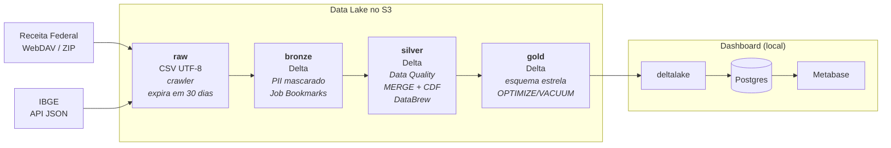

# Pipeline Good Lion: Data Lake de CNPJ no AWS Glue

Pipeline de dados distribuído que leva a base pública de **CNPJ da Receita Federal** do arquivo bruto até um esquema estrela pronto para análise, no ecossistema **AWS Glue** (Glue Studio, Data Catalog, Crawlers, Workflows, Data Quality e DataBrew), com camadas Bronze, Silver e Gold em **Delta Lake**.

Projeto da disciplina de pipeline de dados distribuído da Infnet.

## Perguntas de negócio

O dashboard (Metabase) responde a três perguntas:

1. **Em quais regiões há mais MEI, ME, EPP e Demais?** Contagem e proporção por município, UF e região.
2. **Onde as empresas têm maior capital social?** Média e soma por município, UF e região.
3. **Onde mais se abrem e se fecham empresas e MEIs?** Movimentação mensal, calculada por CDC.

> A base de CNPJ não traz faturamento nem lucro. A métrica financeira é o `capital_social` declarado na abertura. A mediana foi descartada: nas "Demais" ela dá R$ 0, porque pelo menos metade dessas empresas declara capital zero.

## Arquitetura



| Camada | Conteúdo | Partição |
|---|---|---|
| `raw` | Cópia fiel da origem, convertida para UTF-8 e com cabeçalho. É o único lugar com PII cru e expira em 30 dias | `ano_mes` |
| `bronze` | Dados tipados, PII mascarado (e-mail, telefone, CPF), endereço e razão social descartados | `ano_mes` |
| `silver` | Limpeza, padronização, regra de empresa ativa e a `silver_empresa_consolidada` (estado atual, com Change Data Feed) | `ano_mes` |
| `gold` | 2 fatos (`fato_empresa_mensal`, `fato_movimentacao_empresa`) e 5 dimensões (`dim_municipio`, `dim_categoria`, `dim_cnae`, `dim_natureza_juridica`, `dim_tempo`) | `ano_mes` nas fatos |

### Glue Workflow

O Workflow `goodlion` roda uma etapa por vez. Cada etapa só começa quando a anterior termina com sucesso, e uma regra bloqueante de Data Quality para o Workflow:

```
definir_mes → ingest_receita ∥ ingest_ibge → crawler raw
  → bronze_* ∥ trigger_databrew → silver_*
  → silver_empresa_consolidada ∥ gold_dim_municipio ∥ gold_dimensoes
  → gold_fato_empresa_mensal ∥ gold_fato_movimentacao_empresa
  → manutencao (OPTIMIZE + VACUUM) → crawlers silver e gold
```

Ele tem um gatilho mensal (dia 20) e também roda sob demanda. Todo job recebe `--ano_mes`, `--bucket` e `--ambiente` (`sample` ou `full`). Cada job tem uma nova tentativa. Como nada é gravado com `append` (só `replaceWhere` por mês ou `MERGE`), reprocessar um mês dá o mesmo resultado.

### Recursos do Glue usados

| Recurso | Onde |
|---|---|
| Jobs visuais do Glue Studio | Bronze, Silver e Gold, versionados como JSON em [glue/jobs/](glue/jobs/) |
| Job Bookmarks | Leitura do `raw` pela Bronze |
| Detect Sensitive Data | Mascaramento de PII na entrada da Bronze |
| Glue Data Quality (DQDL) | Regras bloqueantes e de alerta em [jobs/quality/](jobs/quality/) |
| Delta Lake com Change Data Feed | `MERGE` na consolidada; a fato de movimentação lê as mudanças |
| Crawlers e Data Catalog | Bancos `goodlion_<camada>`, evolução de esquema com `MergeNewColumns` |
| DataBrew | Receita de limpeza dos municípios do IBGE e perfilamento da Silver |
| EventBridge, SNS e CloudWatch | E-mail quando um job falha, logs e dashboard operacional |
| AWS Budgets | Alertas de custo em US$ 5 e US$ 8 |

## Como o código está organizado

O princípio é **SQL é a lógica, Python é o encanamento, JSON é o desenho**. O [scripts/deploy_jobs.py](scripts/deploy_jobs.py) troca os marcadores `@arquivo:<caminho>` dos JSON pelo conteúdo dos `.sql`, `.dqdl` e Custom Transforms e publica os jobs com `create-job`/`update-job`. Assim, o SQL que roda na AWS é o mesmo testado localmente.

```
amostra/      gera o recorte AC/AP/RR usado no desenvolvimento
dashboard/    carga da Gold no Postgres e visões materializadas lidas pelo Metabase
glue/jobs/    grafos visuais dos jobs do Glue Studio (um JSON por job)
infra/        Terraform: S3, IAM, Catalog, crawlers, Workflow, DataBrew, monitoramento, Budgets
ingest/       jobs Python shell de ingestão (Receita, IBGE, disparo do DataBrew)
jobs/
  sql/        lógica dos nós SQL Query, por camada (bronze/, silver/, gold/)
  quality/    regras de Data Quality (DQDL)
  custom/     corpo dos Custom Transforms (gravação Delta, MERGE, CDF, manutenção)
  local.py    executor local que roda os mesmos SQL e Custom Transforms no container do Glue
scripts/      deploy e exportação dos jobs, carga do dashboard a partir da AWS, montagem do Metabase
tests/        testes com pytest
```

## Como inicializar o projeto

O projeto roda inteiro na sua máquina, sem conta na AWS: o MinIO faz o papel do S3 e o container oficial do Glue 5 roda o Spark com Delta Lake. A AWS só entra na [implantação](#implantação-na-aws).

### 1. Pré-requisitos

| Ferramenta | Para quê |
|---|---|
| [Docker](https://docs.docker.com/get-docker/) com Docker Compose | MinIO, Postgres, Metabase e o container do Glue |
| [uv](https://docs.astral.sh/uv/getting-started/installation/) | Ambiente Python. O uv instala sozinho o Python 3.12 indicado no `.python-version` |
| `make` e `git` | Atalhos do [Makefile](Makefile) |
| ~35 GB livres em disco | Um mês completo da Receita ocupa ~26 GB de CSV no MinIO |

### 2. Clonar e configurar

```bash
git clone https://github.com/LuisFelipeMTCS/pipeline_good_lion.git
cd pipeline_good_lion

cp .env.example .env   # troque as senhas "troque-esta-senha"
make setup             # cria o .venv com as versões travadas no uv.lock
```

No `.env`, o `AWS_SECRET_ACCESS_KEY` precisa ser igual ao `MINIO_ROOT_PASSWORD`, e o `AWS_ACCESS_KEY_ID` igual ao `MINIO_ROOT_USER`. É com essas credenciais que o código acessa o MinIO.

### 3. Subir os serviços

```bash
make up
docker compose ps      # todos "running"; o minio-init cria os buckets e sai
```

| Serviço | Endereço | Acesso |
|---|---|---|
| Console do MinIO | http://localhost:9001 | `MINIO_ROOT_USER` / `MINIO_ROOT_PASSWORD` do `.env` |
| Metabase | http://localhost:3001 | Crie o usuário administrador no primeiro acesso |
| Postgres | `localhost:5432`, banco `dashboard` | `POSTGRES_USER` / `POSTGRES_PASSWORD` do `.env` |

O MinIO já começa com os buckets `raw`, `bronze`, `silver`, `gold` e `artifacts`.

### 4. Conferir com os testes

```bash
make test        # testes sem Spark
make test-spark  # testes com Spark, dentro do container do Glue
```

Se os dois passarem, o ambiente está pronto.

### 5. Baixar os dados e gerar a amostra

```bash
make ingest ANO_MES=2026-09       # baixa o mês da Receita para o raw do MinIO (demora: são ~7 GB de ZIP)
make ingest-ibge ANO_MES=2026-09  # municípios da API do IBGE
make amostra ANO_MES=2026-09      # recorte de AC, AP e RR em raw/sample/
```

A amostra precisa do mês completo, porque filtra os estabelecimentos por UF e leva junto as empresas e os registros do Simples correspondentes. Depois de gerada, ela é o que se usa no dia a dia.

### 6. Rodar o pipeline

```bash
make pipeline ANO_MES=2026-09     # bronze → silver → gold da amostra, no container do Glue
```

Ele roda os mesmos `.sql` e Custom Transforms dos jobs da AWS, gravando Delta no MinIO.

O container do Glue não roda Job Bookmarks, Data Quality nem Detect Sensitive Data. Esses três recursos só funcionam na AWS e foram testados lá, sobre a amostra.

### 7. Ver o dashboard

```bash
make dashboard-load ANO_MES=2026-09   # cria as tabelas no Postgres, carrega o mês e atualiza as visões
```

Para montar o painel das 3 perguntas:

1. No Metabase, crie uma chave de API (Admin → Authentication → API Keys).
2. Coloque a chave em `METABASE_API_KEY` no `.env`.
3. Rode `uv run --env-file .env python scripts/metabase.py`.

O script cadastra o Postgres no Metabase e cria a coleção, as perguntas e o painel. Pode rodar de novo depois de cada carga: os títulos acompanham os dados.

Para desligar tudo, use `make down`. Os dados ficam nos volumes do Docker.

## Implantação na AWS

Requisitos: Terraform ≥ 1.9, AWS CLI com o perfil `default` configurado, região `us-east-1`.

```bash
cd infra
cp terraform.tfvars.example terraform.tfvars   # e-mail que recebe os alertas
terraform init
terraform apply
cd ..

make deploy-jobs          # publica os jobs visuais (amostra)
make amostra-aws          # envia a amostra do MinIO para o S3
make workflow ANO_MES=2026-09                  # roda o Workflow sobre o que já está no raw
make workflow ANO_MES=2026-09 INGESTAO=sim     # baixa o mês da Receita antes
make dashboard-load-aws ANO_MES=2026-09        # carrega a Gold da AWS no Postgres local (papel analista)
```

- Os gatilhos do Workflow apontam para os jobs visuais. Numa conta nova, os gatilhos só são criados depois que os jobs existem: rode o `apply`, depois o `make deploy-jobs`, e o `apply` de novo.
- Os JSON de [glue/jobs/](glue/jobs/) guardam o ID da conta nos nomes dos buckets e no papel do IAM. Para implantar em outra conta, troque esse ID.
- Para a base completa (Brasil inteiro), publique os jobs com `uv run python scripts/deploy_jobs.py --ambiente full` e use `AMBIENTE=full` na carga do dashboard. Para voltar à amostra, publique de novo sem a opção.
- O estado do Terraform fica local e fora do Git.

## Testes

```bash
make test        # testes sem Spark (ingestão, deploy, carga do dashboard, catálogo)
make test-spark  # testes que precisam de Spark, dentro do container do Glue
make lint        # ruff
```

## Resultados

A rodada final processou o Brasil inteiro em **2026-09 e 2026-10**:

| | 2026-09 | 2026-10 |
|---|---:|---:|
| Estabelecimentos | 73.366.147 | 73.809.379 |
| Empresas ativas | 26.937.243 | 27.049.048 |
| MEI | 13.396.674 | 13.419.767 |

- **Movimentação em 2026-10:** 417.791 aberturas e 222.107 baixas, saldo de +195.684 empresas.
- **PII:** 0 e-mails, 0 CPFs e 0 telefones na Bronze e na Silver.
- **Data Quality:** as regras bloqueantes pegaram um CNPJ duplicado no arquivo da própria Receita, que a amostra não tinha. O Workflow parou, o caso foi corrigido e a execução foi retomada.
- **Idempotência:** depois de repetir 2026-10, a Gold ficou idêntica, com as mesmas contagens e as mesmas somas de capital social até o centavo.
- **Custo:** cerca de US$ 17,70 brutos em jobs Spark, acima da meta de US$ 10. As maiores parcelas foram o Detect Sensitive Data na base completa e a manutenção, que compactava todos os meses e hoje compacta só o mês processado.

## Limitações e decisões conscientes

- **Fontes JDBC** não foram implementadas, para evitar o custo e a configuração de rede de um RDS.
- A tabela **Sócios** ficou de fora, porque não serve às perguntas de negócio.
- Não existe `dim_empresa`: seriam cerca de 60 milhões de linhas de nomes, que são dados pessoais.
- Sem CI: os testes de Spark dependem do container do Glue.

## Fontes de dados

- [Dados abertos do CNPJ, Receita Federal](https://arquivos.receitafederal.gov.br/), mensal, ZIP com CSV
- [API de Localidades do IBGE](https://servicodados.ibge.gov.br/api/docs/localidades)
- Nomes de colunas seguindo o SDK da [Base dos Dados](https://basedosdados.org/) (`br_me_cnpj`)
