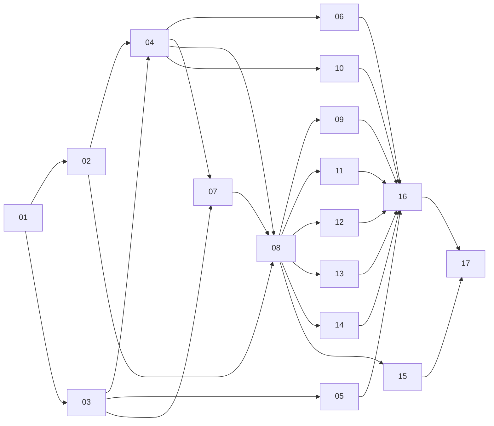

# Backlog — Pipeline Good Lion

Tickets em fatias verticais (tracer bullets) gerados a partir do [PRD](../PRD.md). Cada ticket é um arquivo; o campo **Bloqueado por** de cada um é a fonte da verdade das dependências. Onde cada coisa fica no código e os padrões de nomes estão em [ARQUITETURA](../ARQUITETURA.md).

**Como usar:** pegue qualquer ticket da coluna "Pronto para começar" (todos os bloqueios concluídos). Ao terminar, mude o **Status** no arquivo para `done`, marque os critérios, mova a linha aqui no quadro e faça o commit `Conclui o ticket NN: …`.

## Quadro

### Pronto para começar
- [03 — Base AWS em Terraform e amostra catalogada](03-base-aws-terraform.md) (primeiro ticket com custo na AWS)

### Bloqueado
| # | Ticket | Bloqueado por |
|---|---|---|
| 04 | [Primeiro job visual: Bronze de Estabelecimentos com Bookmarks](04-bronze-estabelecimentos-visual.md) | 02, 03 |
| 05 | [Ingestão da Receita rodando na AWS](05-ingestao-receita-aws.md) | 03 |
| 06 | [Alertas de falha por e-mail e observabilidade](06-alertas-e-observabilidade.md) | 04 |
| 07 | [Municípios Receita × IBGE → dim_municipio](07-municipios-receita-ibge.md) | 03, 04 |
| 08 | [Pergunta 1: MEI/ME/EPP/Demais por região](08-pergunta-1-categorias-por-regiao.md) | 02, 04, 07 |
| 09 | [Pergunta 2: capital social por região](09-pergunta-2-capital-social.md) | 08 |
| 10 | [PII mascarado na Bronze](10-pii-mascarado-na-bronze.md) | 04 |
| 11 | [Data Quality na Silver](11-data-quality-silver.md) | 08 |
| 12 | [Pergunta 3: aberturas e fechamentos via CDC](12-pergunta-3-cdc-movimentacao.md) | 08 |
| 13 | [Arquivos pequenos: OPTIMIZE/VACUUM com evidência](13-arquivos-pequenos-optimize-vacuum.md) | 08 |
| 14 | [Catálogo da Silver/Gold e evolução de esquema](14-catalogo-e-evolucao-de-esquema.md) | 08 |
| 15 | [Perfilamento DataBrew da silver_estabelecimentos](15-perfilamento-databrew.md) | 08 |
| 16 | [Workflow ponta a ponta](16-workflow-ponta-a-ponta.md) | 05, 06, 09, 10, 11, 12, 13, 14 |
| 17 | [Rodada final na base completa](17-rodada-final-base-completa.md) | 15, 16 |

### Em andamento
- [02 — Tracer local: empresas ativas por UF no Metabase](02-tracer-local-ativas-por-uf.md) (falta o gráfico no Metabase)

### Concluído
- [01 — Ambiente local e amostra AC/AP/RR](01-ambiente-local-e-amostra.md)

## Grafo de dependências

**Caminho crítico:** 01 → 03 → 04 → 07 → 08 → 12 → 16 → 17. São 8 tickets em sequência até a entrega de 09/11/2026. O 02 precisa terminar antes do 04, porque o job visual usa o SQL da Bronze testado nele; como só falta o gráfico, não atrasa o caminho. Os tickets 05, 06 e 10 ficam fora do caminho e podem andar em paralelo.
